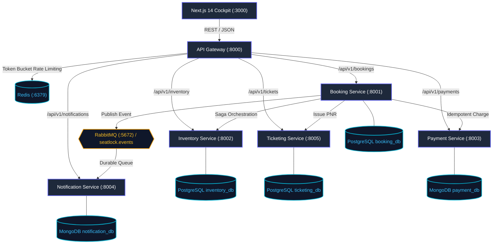

# SeatLock: Distributed High-Concurrency Flash-Sale & Tatkal Reservation Platform
## Scalable Services (SEZG583) — Assignment 1 (13 Marks)

[](https://docs.docker.com/compose/)
[](https://www.python.org/)
[](https://nodejs.org/)
[](https://nextjs.org/)
[](https://www.postgresql.org/)
[](https://www.mongodb.com/)
[](https://redis.io/)
[](https://www.rabbitmq.com/)

**Institution**: Birla Institute of Technology and Science (BITS), Pilani  
**Degree**: M.Tech in Software Systems (WILP)  
**Course**: Scalable Services (SEZG583)  
**Academic Year**: 2026–2027  

---

## Executive Overview

**SeatLock** is an enterprise-grade distributed microservices reservation engine engineered to handle extreme burst concurrency and transactional failure modes. The platform is modeled on three high-velocity reservation domains:
1. **IRCTC 10:00 AM Railway Tatkal Rush**: Opening of air-conditioned train coach quotas where demand exceeds capacity by $100\times$ in seconds.
2. **Concert Arena Flash-Sales**: Stadium entertainment tours (e.g., Coldplay World Tour VIP lounge passes).
3. **Intercity Express Sleeper Buses**: Overnight interstate transit (Bangalore to Goa Volvo 9600 Multi-Axle berths).

SeatLock is built from the ground up to eliminate overbooking anomalies, double debits under network retries, and ghost seat locks from partial distributed failures.

---

## Architecture & Service Topology

The system comprises **5 autonomous microservices**, an **API Gateway**, a **Next.js 14 real-time dashboard cockpit**, and **4 polyglot data stores**, strictly enforcing the **Database-per-Service** pattern with zero cross-database queries:



### Microservices Specification & Port Mappings

| Service | Port | Tech Stack | Dedicated Datastore | Key Responsibility |
| :--- | :---: | :--- | :--- | :--- |
| **Frontend Cockpit** | `3000` | Next.js 14, React 18, Vanilla CSS | Browser LocalStorage | Real-time cockpit, interactive coach selector, telemetry bar, challenge visualizers. |
| **API Gateway** | `8000` | Node.js 22, Express | Redis (:6379) | Reverse proxy, token-bucket rate limiting (200 req/min), `X-Correlation-ID` tracing. |
| **Booking Service** | `8001` | Python 3.12, FastAPI, SQLAlchemy | PostgreSQL `booking_db` | Distributed Saga Orchestrator, multi-step transaction lifecycle, compensating rollback. |
| **Inventory Service** | `8002` | Python 3.12, FastAPI, SQLAlchemy | PostgreSQL `inventory_db` | Atomic conditional seat decrements, zero overbooking guarantees (`BR1` & `BR2`). |
| **Payment Service** | `8003` | Node.js 22, Express, Mongoose | MongoDB `payment_db` | Two-Phase cryptographic SHA-256 idempotency ledger (`BR3`), concurrent lock handling. |
| **Notification Service**| `8004` | Node.js 22, Express, amqplib | MongoDB `notification_db` | RabbitMQ topic consumer, consumer-side deduplication store, SMS/Email dispatch. |
| **Ticketing Service** | `8005` | Python 3.12, FastAPI, SQLAlchemy | PostgreSQL `ticketing_db` | Deterministic berth allocation, 10-digit Indian Railway PNR & digital security barcode. |

---

## Core Business Rules (`BR1` – `BR4`)

| Rule | Name | Invariant / Guarantee | Enforcement Mechanism |
| :---: | :--- | :--- | :--- |
| **`BR1`** | **Zero Overbooking Invariant** | Available seats never drop below zero ($A \ge 0$). Capacity is strictly conserved. | Atomic single-query SQL conditional decrement: `UPDATE seat_inventories SET available_seats = available_seats - :qty WHERE available_seats >= :qty`. |
| **`BR2`** | **Atomic Concurrency Guarantee** | When $M > N$ concurrent requests contest $N$ seats, exactly $N$ succeed (HTTP 201) and $M-N$ fail (HTTP 409 Conflict). | PostgreSQL MVCC row-level write locking in single atomic round-trip. |
| **`BR3`** | **Two-Phase Cryptographic Idempotency** | Replaying identical `Idempotency-Key` returns cached response with `X-Idempotent-Replay: true`. Altered body returns HTTP 422. Simultaneous race results in 1 charge. | Canonical JSON body normalization, SHA-256 payload hashing, MongoDB atomic lock and 24h TTL ledger. |
| **`BR4`** | **Automated Saga Compensating Rollback** | Downstream payment or ticketing decline triggers automatic inventory release with zero leaked seats. | Forward-orchestrated Saga state machine with reverse compensating endpoint `POST /api/v1/inventory/release`. |

---

## Quick Start (Single-Command Launch)

### Prerequisites
- [Docker](https://docs.docker.com/get-docker/) & [Docker Compose v2+](https://docs.docker.com/compose/)
- [Python 3.10+](https://www.python.org/) (for running verification benchmark scripts)

### 1. Launch All Services
From the repository root directory, execute:

```bash
docker compose up -d
```

This single command launches all 11 production-grade containers in proper dependency sequence:
- `seatlock-postgres` (PostgreSQL 16 on `:5432` with auto-initialized schemas)
- `seatlock-mongo` (MongoDB 7 on `:27017` with indexes)
- `seatlock-redis` (Redis 7 on `:6379`)
- `seatlock-rabbitmq` (RabbitMQ 3.13 on `:5672` / Management on `:15672`)
- 5 microservices (`inventory`, `booking`, `payment`, `ticketing`, `notification`)
- `seatlock-api-gateway` on `:8000`
- `seatlock-frontend` on `:3000`

### 2. Verify System Health
Run the automated pre-flight healthcheck:

```bash
python scripts/verify_phase1_health.py
```

Expected output:
```
==================================================
  SeatLock Microservices Health Verification
==================================================
[PASS] API Gateway          (http://localhost:8000/health) -> 200 OK
[PASS] Booking Service      (http://localhost:8001/health) -> 200 OK
[PASS] Inventory Service    (http://localhost:8002/health) -> 200 OK
[PASS] Payment Service      (http://localhost:8003/health) -> 200 OK
[PASS] Notification Service (http://localhost:8004/health) -> 200 OK
[PASS] Ticketing Service    (http://localhost:8005/health) -> 200 OK
==================================================
ALL 6 MICROSERVICES ARE HEALTHY & OPERATIONAL!
==================================================
```

### 3. Access the Next.js 14 Cockpit
Open your web browser and navigate to:
```
http://localhost:3000
```
Interact with the live coach layouts, select berths, simulate checkouts, and trigger real-time challenge benchmarks directly from the UI.

---

## Automated Engineering Challenge Verification

All four assignment challenges include self-contained automated Python test runners that execute against live containers and verify edge-case mathematical properties:

### Challenge 1: Concurrency & Overbooking Elimination (`BR1` & `BR2`)
Fires 20 simultaneous parallel requests against a quota of 5 Tatkal seats.
```bash
python scripts/challenge1_concurrency.py
```
- **Observed Result**: Exactly 5 requests succeed (HTTP 201), exactly 15 are rejected (HTTP 409 Conflict), final remaining quota is verified at 0. Zero overselling.
- **Evidence**: [`evidence/challenge-1-concurrency/concurrency_run.log`](file:///c:/BITS/Sem%203/SS/Assignments/SS-Assignment-1/evidence/challenge-1-concurrency/concurrency_run.log)

### Challenge 2: Cryptographic Idempotency & Replay Protection (`BR3`)
Verifies sequential replay, body tampering detection, and 10-thread simultaneous race.
```bash
python scripts/challenge2_idempotency.py
```
- **Observed Result**: Replay returns cached charge with `X-Idempotent-Replay: true`. Tampered payload returns HTTP 422 Unprocessable Entity. 10 simultaneous threads yield exactly 1 MongoDB charge.
- **Evidence**: [`evidence/challenge-2-idempotency/idempotency_run.log`](file:///c:/BITS/Sem%203/SS/Assignments/SS-Assignment-1/evidence/challenge-2-idempotency/idempotency_run.log)

### Challenge 3D: RabbitMQ Broker Deduplication & Offline Catch-Up
Verifies AMQP consumer deduplication and offline message survival without data loss.
```bash
python scripts/challenge3_event_driven.py
```
- **Observed Result**: Duplicate events safely discarded. When notification service is stopped, 3 events queue up in RabbitMQ. Upon restart, all 3 events drain and persist to MongoDB with 0% loss.
- **Evidence**: [`evidence/challenge-3-event-driven/event_driven_run.log`](file:///c:/BITS/Sem%203/SS/Assignments/SS-Assignment-1/evidence/challenge-3-event-driven/event_driven_run.log)

### Challenge 3C: Distributed Saga Orchestration & Rollback (`BR4`)
Verifies forward transaction coordination and automated compensating rollback on failure.
```bash
python scripts/challenge3_saga_e2e.py
```
- **Observed Result**: Happy path confirms booking and issues PNR. Simulated payment decline triggers automatic inventory release call `POST /api/v1/inventory/release`. Available seats verified restored to pool with zero leakage.
- **Evidence**: [`evidence/challenge-3-saga/saga_run.log`](file:///c:/BITS/Sem%203/SS/Assignments/SS-Assignment-1/evidence/challenge-3-saga/saga_run.log)

---

## Automated Unit Test Suites

Run individual unit test suites across Python and Node.js microservices:

```bash
# 1. Inventory Service Unit Tests (BR1 & BR2 Bounds)
docker compose exec inventory-service pytest -v

# 2. Payment Service Unit Tests (BR3 Idempotency & SHA-256)
docker compose exec payment-service npm test

# 3. Ticketing Service Unit Tests (Berth Allocation & PNR)
docker compose exec ticketing-service pytest -v

# 4. Booking Service Unit Tests (BR4 Saga Compensation)
docker compose exec booking-service pytest -v
```

---

## Core API Endpoints Reference

All external requests route through the **API Gateway** on port `8000`:

| Method | Endpoint | Description |
| :--- | :--- | :--- |
| `GET` | `/health` | API Gateway and Redis health status |
| `GET` | `/api/v1/inventory/quotas` | List all active quota pools across domains |
| `GET` | `/api/v1/inventory/quotas/:id` | Get real-time seat availability for a quota |
| `POST` | `/api/v1/inventory/reserve` | Atomically reserve seats (`BR1` & `BR2`) |
| `POST` | `/api/v1/inventory/release` | Compensating release of held inventory (`BR4`) |
| `POST` | `/api/v1/payments/charge` | Charge payment with `Idempotency-Key` header (`BR3`) |
| `GET` | `/api/v1/payments/:id` | Retrieve payment record by ID |
| `POST` | `/api/v1/tickets/issue` | Allocate berths and issue 10-digit Indian Railway PNR |
| `GET` | `/api/v1/tickets/pnr/:pnr` | Lookup ticket details by PNR |
| `POST` | `/api/v1/bookings` | Execute complete Distributed Saga booking transaction |
| `GET` | `/api/v1/bookings/:id` | Get booking status and Saga transaction history |
| `GET` | `/api/v1/notifications/logs` | Query consumed notification dispatches |

Complete OpenAPI 3.0 specification files are exported in [`docs/openapi/`](file:///c:/BITS/Sem%203/SS/Assignments/SS-Assignment-1/docs/openapi/).

---

## Submission Deliverables & Documentation Index

All primary academic submission deliverables reside in the [`submission/`](file:///c:/BITS/Sem%203/SS/Assignments/SS-Assignment-1/submission/) directory:

- 📄 [**Design and Technical Report** (`submission/DESIGN_AND_TECHNICAL_REPORT.md`)](file:///c:/BITS/Sem%203/SS/Assignments/SS-Assignment-1/submission/DESIGN_AND_TECHNICAL_REPORT.md): Comprehensive 10-section academic report with Mermaid diagrams, formulas, tables, and trade-off analyses.
- 🎬 [**Demonstration Video Script** (`submission/DEMO_VIDEO_SCRIPT.md`)](file:///c:/BITS/Sem%203/SS/Assignments/SS-Assignment-1/submission/DEMO_VIDEO_SCRIPT.md): Complete 8–10 minute scene-by-scene script divided across all 3 team members.
- ✅ [**Assignment Compliance Checklist** (`submission/SUBMISSION_CHECKLIST.md`)](file:///c:/BITS/Sem%203/SS/Assignments/SS-Assignment-1/submission/SUBMISSION_CHECKLIST.md): Point-by-point verification against the course evaluation rubric and 5 mandatory conditions.
- 🤝 [**AI Declaration & Team Contribution Matrix** (`submission/AI_DECLARATION_AND_CONTRIBUTIONS.md`)](file:///c:/BITS/Sem%203/SS/Assignments/SS-Assignment-1/submission/AI_DECLARATION_AND_CONTRIBUTIONS.md): AI usage boundaries and 33.3% equal contribution distribution across team members.
- 📁 [**Evidence Directory** (`evidence/`)](file:///c:/BITS/Sem%203/SS/Assignments/SS-Assignment-1/evidence/): Unaltered raw terminal logs and architectural READMEs for all challenges.

---

## Repository Structure

```
SS-Assignment-1/
├── README.md                           # Master Project Readme (This document)
├── docker-compose.yml                  # 11-container Docker orchestration specification
├── gateway/                            # Node.js API Gateway (Port 8000, Redis rate limiting)
├── frontend/                           # Next.js 14 Live Cockpit (Port 3000, dark glassmorphism)
├── services/                           # 5 autonomous business microservices
│   ├── booking/                        # Distributed Saga Orchestrator (:8001, booking_db)
│   ├── inventory/                      # Atomic conditional decrement (:8002, inventory_db)
│   ├── payment/                        # Cryptographic SHA-256 idempotency (:8003, payment_db)
│   ├── notification/                   # RabbitMQ event consumer (:8004, notification_db)
│   └── ticketing/                      # PNR generation & berth allocation (:8005, ticketing_db)
├── docker/                             # Database initialization scripts
│   ├── postgres/                       # Schemas for inventory_db, booking_db, ticketing_db
│   └── mongo/                          # Collections and TTL indexes for payment_db, notification_db
├── scripts/                            # Automated benchmark runners
│   ├── verify_phase1_health.py         # System health verification
│   ├── challenge1_concurrency.py       # 20-thread concurrency benchmark
│   ├── challenge2_idempotency.py       # Two-phase idempotency benchmark
│   ├── challenge3_event_driven.py      # AMQP broker & offline catch-up benchmark
│   └── challenge3_saga_e2e.py          # End-to-end Saga compensating rollback benchmark
├── evidence/                           # Verified execution logs & diagrams
│   ├── challenge-1-concurrency/
│   ├── challenge-2-idempotency/
│   ├── challenge-3-event-driven/
│   └── challenge-3-saga/
├── docs/                               # Architectural decision records & OpenAPI specifications
│   ├── openapi/                        # OpenAPI 3.0 JSON specifications for all services
│   ├── plans/                          # Implementation milestones
│   └── changes/SESSION_CHANGELOG.md    # Complete session audit trail
└── submission/                         # Formal course submission deliverables
    ├── DESIGN_AND_TECHNICAL_REPORT.md  # 10-section formal academic design report
    ├── DEMO_VIDEO_SCRIPT.md            # 8-to-10 minute presentation script
    ├── SUBMISSION_CHECKLIST.md         # Full compliance checklist
    └── AI_DECLARATION_AND_CONTRIBUTIONS.md # Contribution matrix & AI statement
```

---

## Assignment 2 Roadmap (Minikube / Kubernetes)

As part of the two-stage course plan, Assignment 2 will transition SeatLock from local Docker Compose to **Minikube / Kubernetes**:
1. **Container Packaging**: Helm charts for each microservice with resource limits and readiness/liveness probes.
2. **Horizontal Pod Autoscaling (HPA)**: Automated pod scaling based on CPU utilization and request throughput.
3. **Resilience & Fault Tolerance**: Kubernetes network policies, Secret managers, and Circuit Breaker sidecars.
4. **Cloud-Native Observability**: Prometheus scraping metrics and Grafana dashboards for real-time SLA tracking.
