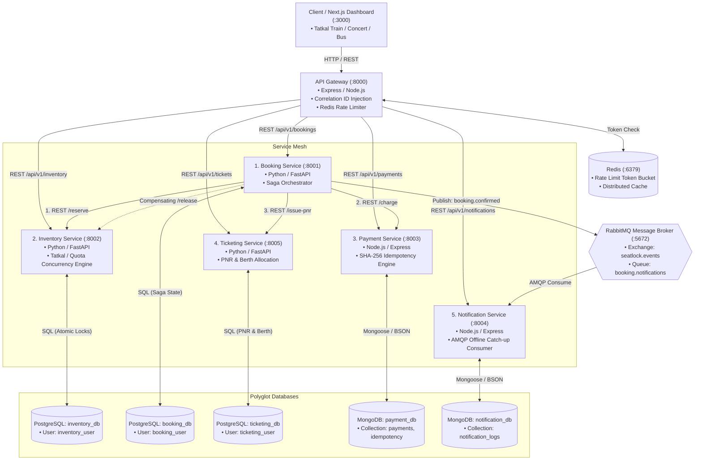
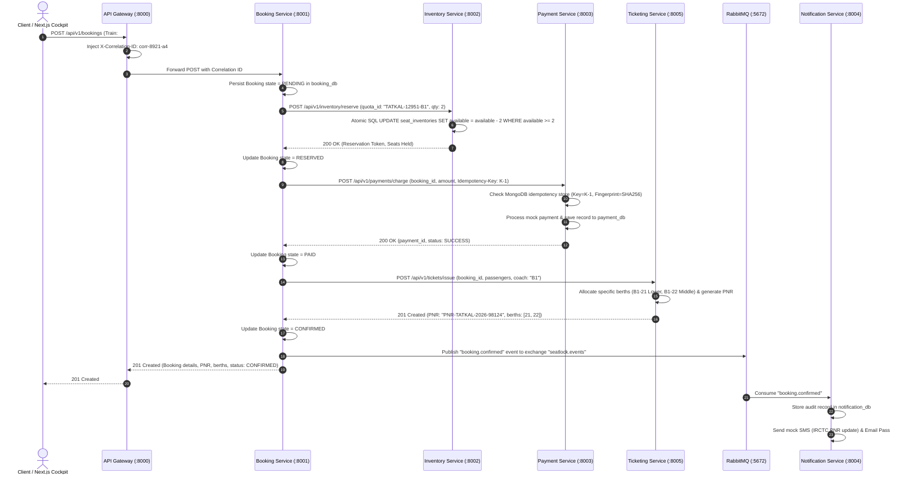
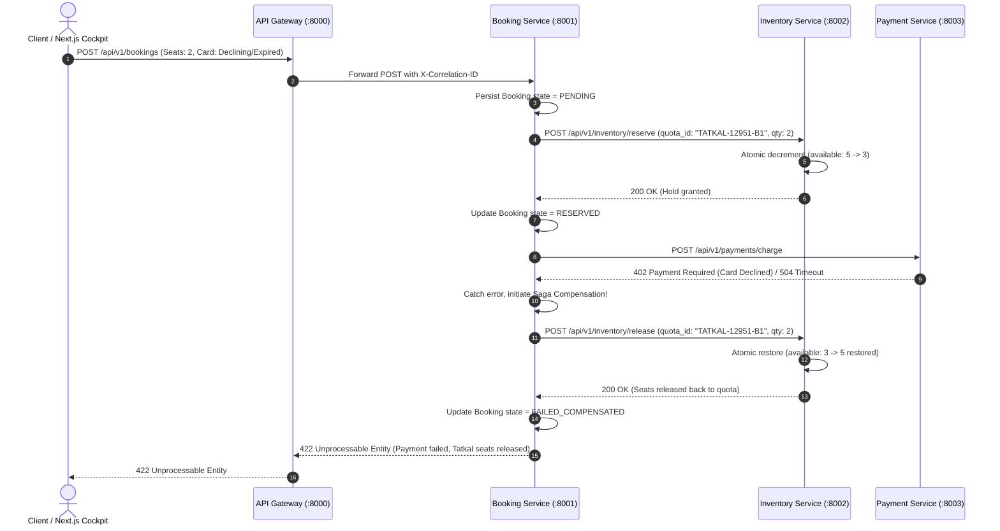

# "SeatLock" Microservices Architecture & System Design
## Scalable Services (SEZG583) - Assignment 1 Documentation

---

## 1. System Component Diagram (5 Autonomous Microservices)

The following Mermaid diagram visualizes the 5-microservice architecture, API Gateway, polyglot databases, and RabbitMQ broker:



---

## 2. Sequence Diagram: Happy Path Multi-Service Saga



---

## 3. Sequence Diagram: Failure Path & Compensating Rollback (Saga)



---

## 4. Uniform Error Response Schema

```json
{
  "status": "error",
  "code": "INSUFFICIENT_INVENTORY",
  "message": "Only 3 seats remaining in Tatkal quota; requested 5 seats.",
  "correlation_id": "corr-8921-a4",
  "service": "inventory-service",
  "timestamp": "2026-10-18T11:35:00Z",
  "details": {
    "quota_id": "TATKAL-12951-B1",
    "requested": 5,
    "available": 3
  }
}
```
