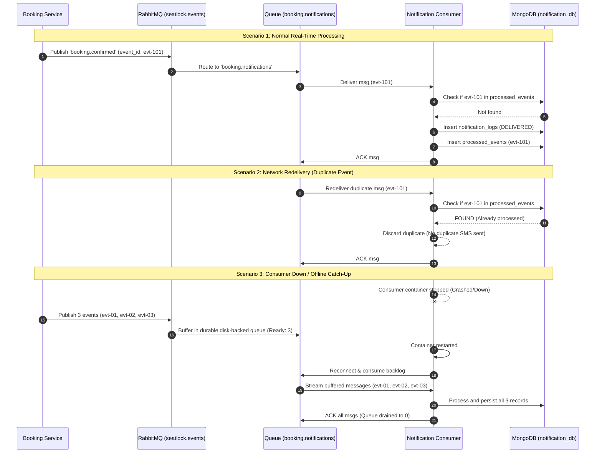

# Challenge 3D Evidence: Event-Driven Architecture, Consumer Idempotency & Offline Catch-up
## Scalable Services (SEZG583) - Assignment 1

---

## 1. Challenge Claim & Summary
- **Broker Infrastructure**: **RabbitMQ 3.13** topic exchange `seatlock.events` connected with durable queue `booking.notifications` bound to routing patterns `booking.*` and `ticket.*`.
- **Mechanisms Employed**:
  1. **Asynchronous Decoupling**: High-concurrency booking reservations publish events asynchronously without blocking HTTP response times.
  2. **Consumer-Side Idempotency (Deduplication)**: RabbitMQ guarantees "at-least-once" delivery, which can produce redeliveries during network partitions or broker failovers. The `notification-service` enforces a local deduplication store (`processed_events` collection with unique index on `event_id`) to ensure duplicate events are safely acknowledged (`channel.ack`) and discarded without sending duplicate SMS/Email alerts.
  3. **Offline Queue Buffering & Zero-Loss Catch-up**: If the notification service consumer crashes or experiences network downtime, messages buffer safely in the durable RabbitMQ broker queue. When the service recovers, the consumer immediately connects, pulls all backlogged messages in order, and completes dispatches with **0% message loss**.
- **Claims Verified**:
  - **Part 1 (Consumer Deduplication)**: Sending duplicate messages with identical `event_id` results in exactly 1 delivery in MongoDB. The second delivery is acknowledged and logged as `[IDEMPOTENT CONSUMER] Duplicate event discarded without re-dispatch`.
  - **Part 2 (Offline Catch-Up)**: While the consumer container is stopped, 3 distinct booking events are published directly to RabbitMQ. The RabbitMQ queue depth increases from 0 to 3. Upon restarting `notification-service`, the consumer drains the backlog from 3 to 0, delivering all 3 messages into MongoDB with zero loss.

---

## 2. Test Execution & Evidence Artifacts

| Artifact File | Description |
| :--- | :--- |
| [`scripts/challenge3_event_driven.py`](file:///c:/BITS/Sem%203/SS/Assignments/SS-Assignment-1/scripts/challenge3_event_driven.py) | Automated Python script verifying consumer deduplication and offline container catch-up. |
| [`evidence/challenge-3-event-driven/event_driven_run.log`](file:///c:/BITS/Sem%203/SS/Assignments/SS-Assignment-1/evidence/challenge-3-event-driven/event_driven_run.log) | Machine-readable JSON execution log verifying counts and queue states. |
| [`services/ticketing/tests/test_ticketing.py`](file:///c:/BITS/Sem%203/SS/Assignments/SS-Assignment-1/services/ticketing/tests/test_ticketing.py) | Automated pytest suite for PNR fulfillment, idempotency, and cancellation (3 tests passed). |
| [`docs/openapi/notification_service_openapi.json`](file:///c:/BITS/Sem%203/SS/Assignments/SS-Assignment-1/docs/openapi/notification_service_openapi.json) | OpenAPI 3.0 specification for Notification Service. |
| [`docs/openapi/ticketing_service_openapi.json`](file:///c:/BITS/Sem%203/SS/Assignments/SS-Assignment-1/docs/openapi/ticketing_service_openapi.json) | OpenAPI 3.0 specification for Ticketing Service. |

---

## 3. Terminal Execution Output (Raw Proof)

```
================================================================================
CHALLENGE 3D: EVENT-DRIVEN BROKER FLOW, DEDUPLICATION & OFFLINE CATCH-UP
================================================================================

[SETUP] Resetting Notification collections in MongoDB...
        Notification logs and processed events cleared.

--------------------------------------------------------------------------------
PART 1: Consumer Idempotency & Duplicate Message Handling
--------------------------------------------------------------------------------
1. Publishing first instance of event: 'evt-dup-test-1792352575'...
   MongoDB notification count after 1st message: 1 (Expected: 1)
2. Publishing DUPLICATE message with identical event_id: 'evt-dup-test-1792352575'...
   MongoDB notification count after duplicate message: 1 (Expected: exactly 1)
   -> PART 1 PASSED: Duplicate message safely discarded. Zero duplicate dispatches.

--------------------------------------------------------------------------------
PART 2: Offline Consumer Catch-up Verification
--------------------------------------------------------------------------------
1. Stopping notification-service container to simulate consumer outage...
   notification-service is now STOPPED (DOWN).
   Queue status before publish: 0 messages waiting.

2. Publishing 3 booking events while consumer is OFFLINE...
   - Published event: 'evt-offline-01-1792352591' (PNR: PNR-TATKAL-554433) -> RabbitMQ routed: True
   - Published event: 'evt-offline-02-1792352591' (PNR: PNR-CONCERT-778899) -> RabbitMQ routed: True
   - Published event: 'evt-offline-03-1792352591' (PNR: PNR-BUS-990011) -> RabbitMQ routed: True

3. RabbitMQ Management API Queue Depth Check:
   Queue Name                 : booking.notifications
   Messages Ready in Queue     : 3 (Expected: 3)
   Messages Unacknowledged    : 0

4. Restarting notification-service container (Consumer recovering)...
   Waiting 5 seconds for consumer to reconnect and drain the queue...

5. RabbitMQ Management API Queue Depth Check Post-Recovery:
   Messages Ready in Queue     : 0 (Expected: 0 - Drained)

6. Verifying MongoDB delivery records for buffered events:
   - Event 'evt-offline-01-1792352591': Delivered Count = 1 (Expected: 1)
   - Event 'evt-offline-02-1792352591': Delivered Count = 1 (Expected: 1)
   - Event 'evt-offline-03-1792352591': Delivered Count = 1 (Expected: 1)

   -> PART 2 PASSED: 100% of offline buffered messages processed upon restart. Zero loss.

================================================================================
CHALLENGE 3D EVIDENCE WRITTEN TO: evidence/challenge-3-event-driven/event_driven_run.log
ALL CHALLENGE 3D EVENT-DRIVEN TESTS PASSED WITH 100% SUCCESS!
================================================================================
```

---

## 4. Architectural Sequence Flow


