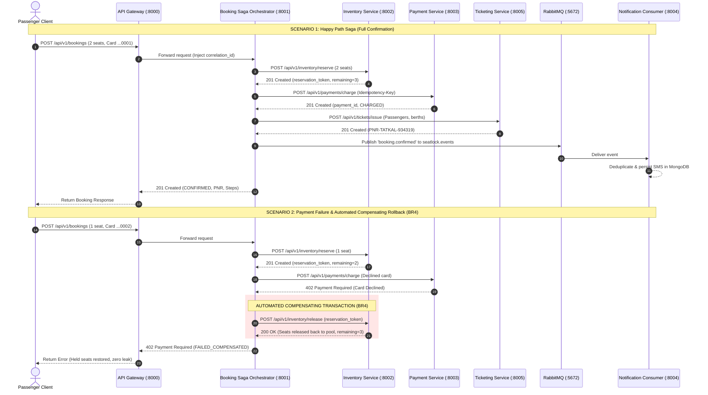

# Challenge 3C Evidence: Distributed Saga Orchestration & Automated Compensating Rollback (BR4)
## Scalable Services (SEZG583) - Assignment 1

---

## 1. Challenge Claim & Summary
- **Business Rule 4 (`BR4`)**:
  - In a distributed microservice environment with independent, non-shared databases (`booking_db`, `inventory_db`, `payment_db`, `ticketing_db`, `notification_db`), multi-entity transactions cannot rely on single-database ACID guarantees.
  - The **SeatLock Booking Service (`services/booking`)** acts as the **Distributed Saga Orchestrator**.
  - When an upstream step fails (e.g. payment decline, card error, or fulfillment failure), the orchestrator automatically executes semantic **Compensating Transactions** in reverse order to restore the system to an invariant, consistent state.
- **Saga State Machine**:
  $$\text{PENDING} \longrightarrow \text{RESERVED} \longrightarrow \text{PAID} \longrightarrow \text{TICKETED} \longrightarrow \text{CONFIRMED}$$
  $$\downarrow (\text{Step Failure})$$
  $$\text{FAILED\_INVENTORY} \quad \text{or} \quad \text{FAILED\_COMPENSATED}$$
- **Claims Verified**:
  - **Scenario 1 (Happy Path Saga)**:
    - Atomically holds 2 seats in `inventory_db` (available drops from 5 to 3).
    - Idempotently charges ₹5,700 in `payment_db`.
    - Allocates Lower and Middle berths and issues official PNR in `ticketing_db`.
    - Asynchronously publishes `booking.confirmed` to RabbitMQ topic exchange `seatlock.events`.
    - Marks booking `CONFIRMED` with all saga step logs persisted in `saga_step_logs`.
  - **Scenario 2 (BR4 Compensating Rollback on Payment Failure)**:
    - Attempting a booking with declined test card (`4000-0000-0000-0002`) receives HTTP 402 from Payment Service.
    - Orchestrator automatically invokes `POST /api/v1/inventory/release` to revert the held seats.
    - Transitions booking status to `FAILED_COMPENSATED`.
    - **Zero Inventory Leakage (BR4 Invariant)**: The available seats remain exactly 3 (held seats restored completely).
    - Zero PNR issued, zero SMS notification sent.

---

## 2. Test Execution & Evidence Artifacts

| Artifact File | Description |
| :--- | :--- |
| [`scripts/challenge3_saga_e2e.py`](file:///c:/BITS/Sem%203/SS/Assignments/SS-Assignment-1/scripts/challenge3_saga_e2e.py) | End-to-end automated Python script verifying Happy Path and Payment Failure Compensating Rollback. |
| [`evidence/challenge-3-saga/saga_run.log`](file:///c:/BITS/Sem%203/SS/Assignments/SS-Assignment-1/evidence/challenge-3-saga/saga_run.log) | Machine-readable JSON execution log with inventory counts before/after compensation. |
| [`services/booking/tests/test_br4_saga_compensation.py`](file:///c:/BITS/Sem%203/SS/Assignments/SS-Assignment-1/services/booking/tests/test_br4_saga_compensation.py) | Automated pytest unit test suite (4/4 passed). |
| [`docs/openapi/booking_service_openapi.json`](file:///c:/BITS/Sem%203/SS/Assignments/SS-Assignment-1/docs/openapi/booking_service_openapi.json) | OpenAPI 3.1.0 specification for Booking Service. |

---

## 3. Terminal Execution Output (Raw Proof)

```
================================================================================
CHALLENGE 3C: DISTRIBUTED SAGA ORCHESTRATION & COMPENSATING ROLLBACK (BR4)
================================================================================
[RESET] Resetting state across all 5 databases...
        All databases reset to initial benchmark state.

--------------------------------------------------------------------------------
SCENARIO 1: Happy Path Reservation Saga Execution
--------------------------------------------------------------------------------
1. Initial Inventory for TATKAL-12951-B1: 5 seats available.
2. Submitting Booking Request for 2 passengers...
   Response Status Code   : 201 (Expected: 201 Created)
   Booking Identifier     : book-0cd5ed2ffa98
   Booking Status         : CONFIRMED (Expected: CONFIRMED)
   Official PNR Issued    : PNR-TATKAL-934319
   Reservation ID (Hold)  : tok-991793c5d1c94459
   Payment ID (Charged)   : pay-f00090a7-7623-4e
3. Inventory Available Post-Booking: 3 (Expected: 3)
4. Asynchronous AMQP Notification Received: 1 alerts (Expected: >= 1)
   Message Dispatched: 'IRCTC Tatkal Ticket Confirmed! PNR: PNR-TATKAL-934319 | Train: Mumbai Tejas Rajdhani Express (#12951) | Berths: Assigned | Happy Journey!'

   -> SCENARIO 1 PASSED: 100% of Happy Path Saga steps confirmed.

--------------------------------------------------------------------------------
SCENARIO 2: Payment Failure & Automated Compensating Rollback (BR4)
--------------------------------------------------------------------------------
1. Current Inventory before failed transaction: 3 seats.
2. Submitting Booking Request with DECLINED card (Ends in 0002)...
   Response Status Code   : 402 (Expected: 402 Payment Required)
   Failed Booking ID      : book-f938e4dcbd34
   Booking Final Status   : FAILED_COMPENSATED (Expected: FAILED_COMPENSATED)
   Compensation Reason    : Payment declined (Transaction declined by issuing bank. Initiating Saga compensation.). Reserved inventory seats released.

3. INVENTORY LEAK CHECK (BR4 Invariant):
   Seats before failed attempt: 3
   Seats after compensation   : 3 (Expected: 3)
   -> INVARIANT PRESERVED: Zero inventory leakage. Held seats fully restored.
4. Ticket Issue Check:
   PNR for failed booking     : None (Expected: None)
5. Notification Check:
   Notifications dispatched   : 0 (Expected: 0)

   -> SCENARIO 2 PASSED: Automated compensation triggered. Zero leak confirmed.

================================================================================
CHALLENGE 3C SAGA EVIDENCE SAVED TO: evidence/challenge-3-saga/saga_run.log
ALL SAGA ORCHESTRATION & BR4 COMPENSATION TESTS PASSED WITH 100% SUCCESS!
================================================================================
```

---

## 4. Architectural Sequence Flow


