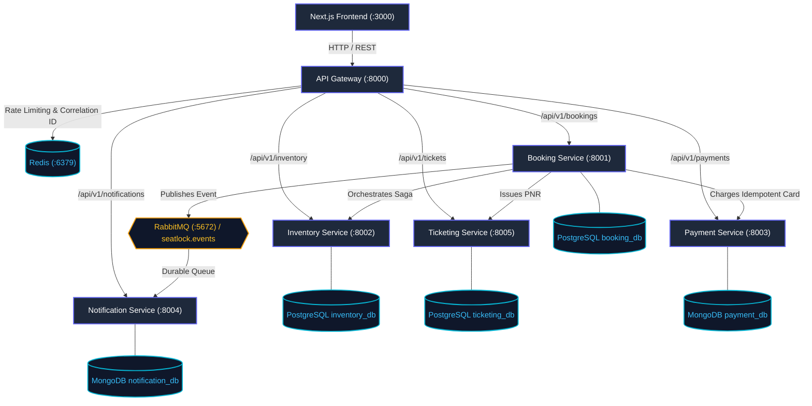
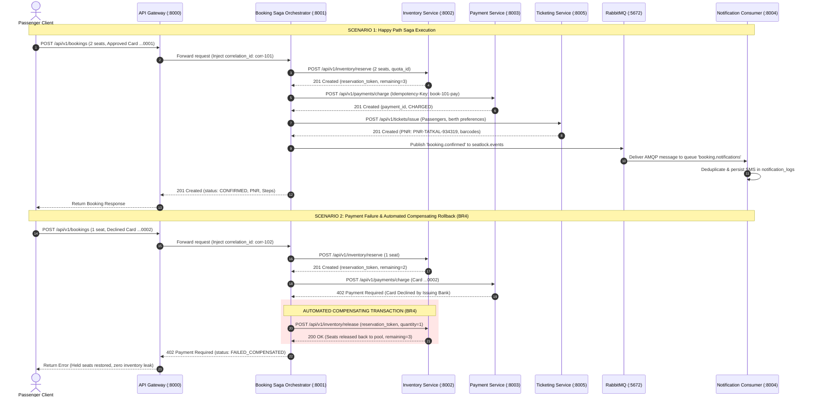
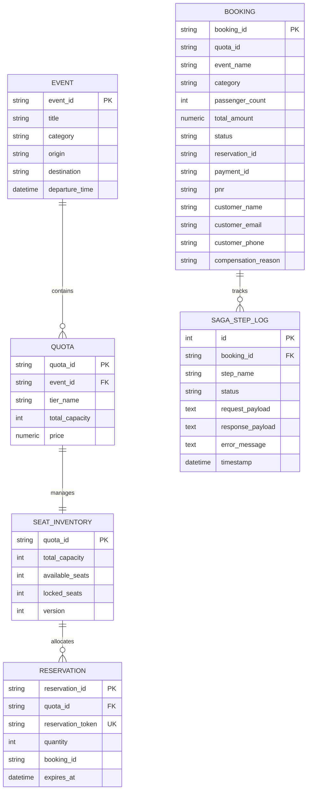
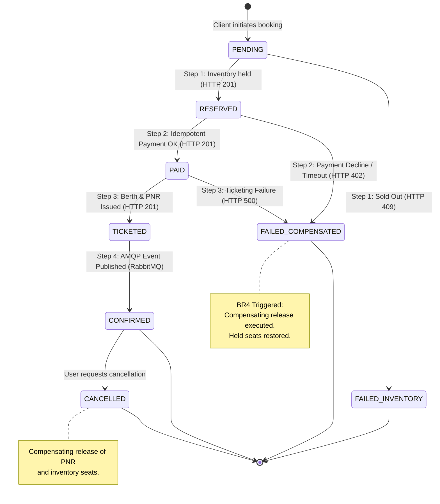

# SeatLock: Distributed High-Concurrency Flash-Sale & Tatkal Reservation Platform
## Design and Technical Report — Scalable Services (SEZG583) | Assignment 1

**Course**: Scalable Services (SEZG583)  
**Degree**: M.Tech in Software Systems, BITS Pilani  
**Assignment**: Assignment 1 (Microservices Architecture, Development & Challenge Verification)  
**Marks Weightage**: 13 Marks (Out of 20 total course assignment marks)  
**Academic Year**: 2026–2027  

---

## Executive Summary

**SeatLock** is a distributed, polyglot microservices platform engineered to solve extreme write-concurrency, double-spending, and partial-failure challenges inherent in high-velocity reservation domains. Specifically modeled on:
1. **IRCTC 10:00 AM Railway Tatkal Rush**: Opening of air-conditioned coach quotas with demand exceeding capacity by $100\times$ within 60 seconds.
2. **Concert Arena Flash-Sales**: High-demand stadium tours (e.g., Coldplay World Tour VIP lounge passes).
3. **Intercity Express Sleeper Buses**: High-occupancy overnight routes (Bangalore to Goa Volvo 9600 Multi-Axle berths).

The platform comprises **5 autonomous microservices**, an **API Gateway**, a **Next.js 14 real-time dashboard cockpit**, and **4 polyglot data stores** (PostgreSQL, MongoDB, Redis, RabbitMQ), strictly enforcing the **Database-per-Service** pattern with zero cross-database queries.

---

## 1. Problem and Scope

### 1.1 Business Problem & Domain Context
High-concurrency reservation systems face the "thundering herd" problem. When booking windows open at a precise millisecond (such as IRCTC Tatkal at 10:00:00 AM), thousands of concurrent client threads contest a limited pool of perishable inventory ($N$ available seats). Naive architectures suffer from three fatal distributed anomalies:
1. **Over-Allocation & Overselling**: Race conditions between reading available inventory and updating it result in negative seat balances.
2. **Double Debit without Ticket Guarantee**: Client retries and network timeouts during payment gateway round-trips cause duplicate financial debits.
3. **Ghost Bookings & Phantom Locks (Distributed Partial Failures)**: If a client's seat is reserved, payment succeeds, but ticketing fulfillment fails, seats remain permanently locked in database tables without issuing a PNR, leaking inventory.

### 1.2 System Scope & Out-of-Scope Boundaries

| In Scope | Out of Scope |
| :--- | :--- |
| Atomic conditional inventory decrement under 20+ simultaneous threads. | Physical credit card processor integration (handled by high-fidelity deterministic mock). |
| Two-phase cryptographic SHA-256 payload idempotency ledger. | Real telecommunication GSM/SMS gateway (simulated via asynchronous AMQP message broker). |
| Distributed Saga orchestration with automated compensating rollbacks (`BR4`). | Multi-region geo-replication (deferred to cloud production). |
| RabbitMQ event-driven asynchronous notification decoupling with offline buffer catch-up. | Kubernetes production deployment (explicitly reserved for Assignment 2 / Minikube). |
| Full polyglot Docker Compose single-command local orchestration. | Real payment refund settlement clearinghouse (mocked via compensating ledger). |

### 1.3 Core Business Rules (Traceability Matrix)

The application formalizes four foundational **Business Rules (BR)**, fully traceable to source code implementations and automated test suites:

| Rule ID | Formal Rule Definition | Architectural Enforcement Mechanism | Code Implementation | Verification Test Suite |
| :--- | :--- | :--- | :--- | :--- |
| **`BR1`** | **Zero Over-Allocation Invariant**: At no point shall the number of confirmed/locked seats exceed the total configured quota capacity ($C$). Available seats $A \ge 0$ at all times. | Atomic single-query conditional decrement: `UPDATE seat_inventories SET available_seats = available_seats - :qty WHERE available_seats >= :qty`. | [`services/inventory/src/repository.py`](file:///c:/BITS/Sem%203/SS/Assignments/SS-Assignment-1/services/inventory/src/repository.py) | [`services/inventory/tests/test_br1_inventory_bound.py`](file:///c:/BITS/Sem%203/SS/Assignments/SS-Assignment-1/services/inventory/tests/test_br1_inventory_bound.py) |
| **`BR2`** | **Atomic Concurrency Guarantee**: When $M$ parallel requests compete for $N$ seats ($M > N$), exactly $N$ reservations must succeed (HTTP 201) and $M-N$ must be rejected (HTTP 409 Conflict). | PostgreSQL row-level write lock and MVCC conditional update in single database round-trip. | [`services/inventory/src/repository.py`](file:///c:/BITS/Sem%203/SS/Assignments/SS-Assignment-1/services/inventory/src/repository.py) | [`scripts/challenge1_concurrency.py`](file:///c:/BITS/Sem%203/SS/Assignments/SS-Assignment-1/scripts/challenge1_concurrency.py) |
| **`BR3`** | **Two-Phase Cryptographic Idempotency**: Submitting an identical `Idempotency-Key` must replay the original cached response with `X-Idempotent-Replay: true`. Reusing a key with altered payload must be rejected with HTTP 422 Unprocessable Entity. | Canonical JSON alphabetical normalization, SHA-256 body fingerprinting, and MongoDB atomic lock with 24h TTL. | [`services/payment/src/middleware/idempotency.js`](file:///c:/BITS/Sem%203/SS/Assignments/SS-Assignment-1/services/payment/src/middleware/idempotency.js) | [`services/payment/tests/test_br3_idempotency.test.js`](file:///c:/BITS/Sem%203/SS/Assignments/SS-Assignment-1/services/payment/tests/test_br3_idempotency.test.js) & [`scripts/challenge2_idempotency.py`](file:///c:/BITS/Sem%203/SS/Assignments/SS-Assignment-1/scripts/challenge2_idempotency.py) |
| **`BR4`** | **Automated Saga Compensating Rollback**: If downstream payment declines or ticketing fulfillment fails during a booking transaction, the orchestrator must automatically release held inventory seats. | Forward-orchestrated Saga state machine with reverse semantic compensating release endpoint `POST /api/v1/inventory/release`. | [`services/booking/src/saga.py`](file:///c:/BITS/Sem%203/SS/Assignments/SS-Assignment-1/services/booking/src/saga.py) | [`services/booking/tests/test_br4_saga_compensation.py`](file:///c:/BITS/Sem%203/SS/Assignments/SS-Assignment-1/services/booking/tests/test_br4_saga_compensation.py) & [`scripts/challenge3_saga_e2e.py`](file:///c:/BITS/Sem%203/SS/Assignments/SS-Assignment-1/scripts/challenge3_saga_e2e.py) |

### 1.4 Why Microservices are Justified (and When They Would NOT Be)
- **Justification**:
  1. **Asymmetric Scalability**: During Tatkal opening (10:00 AM), the Inventory Service experiences read/write traffic $100\times$ higher than the Ticketing or Notification services. In microservices, Inventory can scale independently without scaling the entire monolith.
  2. **Heterogeneous Polyglot Fit**: Inventory and Booking require strict relational integrity and ACID row-level locking (PostgreSQL + Python FastAPI). Payment idempotency and notification logs require flexible schema storage, TTL indexes, and high document ingestion (MongoDB + Node.js).
  3. **Fault Isolation**: A failure in the external SMS provider or Notification consumer must never block passenger seat reservation or payment processing.
- **When Microservices Would NOT Be Justified**:
  - For standard low-traffic CRUD applications ($< 50$ requests/sec), single-team maintenance, or where business boundaries are rapidly evolving, a modular monolith using a single relational database avoids the network overhead, distributed partial failure complexity, and eventual consistency challenges of microservices.

---

## 2. Service Decomposition & Domain Boundaries

The application is decomposed into **5 independent business microservices**, 1 **API Gateway**, and 1 **Next.js Frontend Cockpit**:



### 2.1 Service Responsibility & Database Ownership Table

| Service Name | Primary Responsibility | Tech Stack | Dedicated Database | Data Entities Owned | Why Boundary is Drawn Here | Rejected Alternatives |
| :--- | :--- | :--- | :--- | :--- | :--- | :--- |
| **API Gateway** (`gateway`) | Reverse proxy, dynamic routing, Redis rate limiting (200 req/min), correlation ID injection (`X-Correlation-ID`). | Node.js 22, Express | Redis (:6379) | Rate limit token buckets, gateway metrics. | Single entry-point decoupling clients from internal container IP topology. | Direct client-to-service communication (violates security & rate limiting). |
| **Inventory Service** (`services/inventory`) | Manages seat quotas, enforces atomic decrements, prevents overselling (`BR1`, `BR2`). | Python 3.12, FastAPI, SQLAlchemy 2.0 | PostgreSQL (`inventory_db`) | `events`, `quotas`, `seat_inventories`, `reservations`. | High contention write zone requiring strict ACID isolation and row-level locking. | Merging into Booking Service (would create a monolith and throttle read availability). |
| **Booking Service** (`services/booking`) | Distributed Saga Orchestrator coordinating end-to-end checkout, enforcing compensating rollbacks (`BR4`). | Python 3.12, FastAPI, SQLAlchemy 2.0 | PostgreSQL (`booking_db`) | `bookings`, `saga_step_logs`. | Stateful business transaction coordinator tracking multi-service saga progress. | Choreography without orchestrator (rejected: hard to monitor and audit compensation). |
| **Payment Service** (`services/payment`) | Idempotent credit card debits, cryptographic SHA-256 fingerprinting, chaos latency simulator (`BR3`). | Node.js 22, Express, Mongoose | MongoDB (`payment_db`) | `payments`, `idempotency_records`. | Financial ledger requiring fast document TTL expiration and flexible metadata. | SQL database for idempotency cache (MongoDB TTL indexes are far more efficient). |
| **Ticketing Service** (`services/ticketing`) | Deterministic berth allocation (Lower/Middle/Upper/VIP), Indian Railway 10-digit PNR issuance, digital barcodes. | Python 3.12, FastAPI, SQLAlchemy 2.0 | PostgreSQL (`ticketing_db`) | `pnrs`, `tickets`. | Separate business capability for ticket fulfillment and verification. | Generating PNR inside Booking Service (violates single responsibility principle). |
| **Notification Service** (`services/notification`) | AMQP topic consumer, message deduplication, mock SMS/Email dispatches (`BR-Deduplication`). | Node.js 22, Express, amqplib, Mongoose | MongoDB (`notification_db`) | `notification_logs`, `processed_events`. | Asynchronous event sink; failures here must never block core booking flow. | Synchronous HTTP calls from Booking to send emails (would add 500ms latency to checkout). |
| **Frontend Cockpit** (`frontend`) | Live interactive dashboard, real-time berth picker, one-click 20-thread concurrency arena, idempotency inspector. | Next.js 14, React 18, Vanilla CSS | None (Stateless) | UI State & browser cache. | User interface layer providing evaluation cockpits and visual proof of correctness. | Server-rendered monolithic templates (decoupled SPA allows clean API testing). |

---

## 3. System Architecture & Transaction Flows

### 3.1 End-to-End Transaction Sequence (Happy Path vs Compensating Failure)



### 3.2 Synchronous vs Asynchronous Communication Decisions
- **Synchronous REST (HTTP/JSON)**: Used for steps that form the strict transactional critical path:
  - `Booking` $\rightarrow$ `Inventory` (immediate reservation hold required).
  - `Booking` $\rightarrow$ `Payment` (immediate charge confirmation required).
  - `Booking` $\rightarrow$ `Ticketing` (immediate PNR generation required).
- **Asynchronous AMQP (RabbitMQ Topic Exchange)**: Used for non-blocking secondary side-effects:
  - `Booking` $\rightarrow$ `RabbitMQ` $\rightarrow$ `Notification` (sending passenger SMS/Email).
  - If the notification service is temporarily down, the message buffers safely in RabbitMQ without impacting client response times.

---

## 4. Data Design & Polyglot Persistence

### 4.1 Database Architecture & Schema Isolation
In strict compliance with the **Database-per-Service** requirement, each service connects exclusively to its isolated database container and user account:
- **`inventory_db` (PostgreSQL)**: Connected via user `inventory_user`.
- **`booking_db` (PostgreSQL)**: Connected via user `booking_user`.
- **`ticketing_db` (PostgreSQL)**: Connected via user `ticketing_user`.
- **`payment_db` (MongoDB)**: Connected via user `payment_user`.
- **`notification_db` (MongoDB)**: Connected via user `notif_user`.

Cross-service data references are strictly maintained using **logical business keys** (`booking_id`, `quota_id`, `pnr`, `reservation_token`) without foreign keys or database links.

### 4.2 Entity Relationship Diagrams (PostgreSQL Services)



### 4.3 MongoDB Document Models

#### Payment Document (`payment_db.payments`):
```json
{
  "_id": "671542f707f1b219a1234567",
  "payment_id": "pay-f00090a7-7623-4e",
  "booking_id": "book-0cd5ed2ffa98",
  "amount": 5700.00,
  "currency": "INR",
  "payment_method": "CARD",
  "card_last4": "0001",
  "status": "CHARGED",
  "created_at": "2026-10-20T18:16:11.234Z"
}
```

#### Idempotency Record (`payment_db.idempotency_records`):
```json
{
  "_id": "671542f707f1b219a1234568",
  "idempotency_key": "book-0cd5ed2ffa98-pay",
  "request_fingerprint": "8b9f1d04481d45d8b74c53c4852f86235bca253cf9d91f2479e563ad2a71bf64",
  "status": "COMPLETED",
  "response_status": 201,
  "response_body": { "payment_id": "pay-f00090a7-7623-4e", "status": "CHARGED" },
  "created_at": "2026-10-20T18:16:11.230Z"
}
```

### 4.4 Saga State Machine Diagram



---

## 5. API Design & Gateway Specification

### 5.1 Service Endpoints Matrix

| Service | Method | Endpoint Path | Request Payload Summary | Response Status & Body | Error Codes |
| :--- | :--- | :--- | :--- | :--- | :--- |
| **Gateway** | `GET` | `/health` | None | `200 { "status": "UP" }` | 503 |
| **Inventory** | `GET` | `/api/v1/inventory/items` | None | `200 List[EventDetail]` | 500 |
| **Inventory** | `GET` | `/api/v1/inventory/quotas/:id` | None | `200 QuotaDetail` (available seats) | 404 |
| **Inventory** | `POST` | `/api/v1/inventory/reserve` | `{ quota_id, quantity, booking_id }` | `201 { reservation_token, remaining }` | 409 (`INSUFFICIENT_INVENTORY`), 404 |
| **Inventory** | `POST` | `/api/v1/inventory/release` | `{ reservation_token, quota_id, quantity }` | `200 { status: "RELEASED", available }` | 404 |
| **Payment** | `POST` | `/api/v1/payments/charge` | Headers: `Idempotency-Key`<br>`{ booking_id, amount, card_number }` | `201 { payment_id, status: "CHARGED" }`<br>Header: `X-Idempotent-Replay` | 402 (Declined), 422 (`PAYLOAD_MISMATCH`) |
| **Ticketing** | `POST` | `/api/v1/tickets/issue` | `{ booking_id, quota_id, passengers }` | `201 { pnr, tickets: [berths, barcodes] }` | 400, 500 |
| **Ticketing** | `GET` | `/api/v1/tickets/pnr/:pnr` | None | `200 IssueTicketResponse` | 404 (`PNR_NOT_FOUND`) |
| **Ticketing** | `POST` | `/api/v1/tickets/cancel` | `{ pnr, reason }` | `200 { status: "CANCELLED" }` | 404 |
| **Booking** | `POST` | `/api/v1/bookings` | `{ quota_id, passengers, payment }` | `201 BookingResponse (CONFIRMED, PNR)` | 402, 409, 500 (`FAILED_COMPENSATED`) |
| **Booking** | `GET` | `/api/v1/bookings/:id` | None | `200 BookingResponse` with Saga step trace | 404 |
| **Notification** | `GET` | `/api/v1/notifications/logs` | None | `200 List[NotificationLog]` | 500 |

### 5.2 OpenAPI 3.0 Specifications
Complete, standards-compliant OpenAPI specifications are exported and available in the repository:
- [`docs/openapi/inventory_service_openapi.json`](file:///c:/BITS/Sem%203/SS/Assignments/SS-Assignment-1/docs/openapi/inventory_service_openapi.json)
- [`docs/openapi/payment_service_openapi.json`](file:///c:/BITS/Sem%203/SS/Assignments/SS-Assignment-1/docs/openapi/payment_service_openapi.json)
- [`docs/openapi/ticketing_service_openapi.json`](file:///c:/BITS/Sem%203/SS/Assignments/SS-Assignment-1/docs/openapi/ticketing_service_openapi.json)
- [`docs/openapi/booking_service_openapi.json`](file:///c:/BITS/Sem%203/SS/Assignments/SS-Assignment-1/docs/openapi/booking_service_openapi.json)
- [`docs/openapi/notification_service_openapi.json`](file:///c:/BITS/Sem%203/SS/Assignments/SS-Assignment-1/docs/openapi/notification_service_openapi.json)

### 5.3 Distributed Tracing & Correlation IDs
Every request entering through the API Gateway is tagged with a unique `X-Correlation-ID` header (or preserves client-supplied ID). This correlation ID is passed across all internal HTTP calls and injected into RabbitMQ AMQP message headers, enabling end-to-end distributed tracing across service logs.

---

## 6. Detailed Engineering Challenges

### 6.1 Challenge 1: Concurrency Control (Contended Resource Allocation)

#### Problem Definition
During IRCTC 10:00 AM Tatkal booking, hundreds of requests compete for 5 remaining seats. In a naive "read-modify-write" implementation:
$$\text{Thread 1 reads } A=5 \longrightarrow \text{Thread 2 reads } A=5 \longrightarrow \text{Both decrement } A=4$$
Both reservations succeed, but only 1 seat was actually decremented, leading to over-allocation ($A < 0$).

#### Mechanism Employed
We implemented **Atomic Database-Level Conditional Update** in PostgreSQL:
```sql
UPDATE seat_inventories 
SET available_seats = available_seats - :quantity, 
    locked_seats = locked_seats + :quantity,
    version = version + 1
WHERE quota_id = :quota_id AND available_seats >= :quantity
RETURNING available_seats, version;
```

#### Why This Choice Over Alternatives?
1. *Application-level mutexes (e.g. Python threading locks)*: Fails completely in multi-container / distributed replicas.
2. *Pessimistic Locking (`SELECT ... FOR UPDATE`)*: Serializes all requests, inducing database connection pool exhaustion and deadlocks under load.
3. *Optimistic Locking with retry loops*: High retry storm overhead when 95% of requests will fail anyway.
4. *Chosen Atomic Conditional Decrement*: Executes in a single database round-trip, leveraging PostgreSQL's native row-level write lock. If `available_seats < quantity`, zero rows are updated, instantly triggering an immediate HTTP 409 Conflict.

#### Proof of Correctness
- **Benchmark Script**: [`scripts/challenge1_concurrency.py`](file:///c:/BITS/Sem%203/SS/Assignments/SS-Assignment-1/scripts/challenge1_concurrency.py)
- **Execution**: 20 simultaneous worker threads fired at the exact same millisecond against quota `TATKAL-12951-B1` (Capacity = 5).
- **Result**:
  - Exactly **5 requests received HTTP 201 Created**.
  - Exactly **15 requests received HTTP 409 Conflict**.
  - Final database available seats = **0** ($A \ge 0$ invariant preserved).
  - Raw evidence log: [`evidence/challenge-1-concurrency/concurrency_run.log`](file:///c:/BITS/Sem%203/SS/Assignments/SS-Assignment-1/evidence/challenge-1-concurrency/concurrency_run.log).

---

### 6.2 Challenge 2: Cryptographic Idempotency Ledger

#### Problem Definition
Network timeouts between API Gateway and Payment Service often cause clients to retry payment requests. Without strict idempotency, retries cause duplicate credit card debits. Furthermore, malicious or buggy clients may reuse an idempotency key while changing the transaction amount.

#### Mechanism Employed
We implemented **Two-Phase Cryptographic Idempotency Middleware**:
1. **Canonical JSON Normalization**: Recursively sorts request JSON body keys alphabetically to eliminate key order differences.
2. **SHA-256 Fingerprint**:
   $$\text{Fingerprint} = \text{SHA256}(\text{Method} + \text{":"} + \text{Path} + \text{":"} + \text{CanonicalJSONBody})$$
3. **Atomic Two-Phase Locking in MongoDB**:
   - Uses `findOneAndUpdate` with `{ upsert: true }` to atomically insert a `PENDING` record.
   - If an existing record is `COMPLETED`: compares the request fingerprint against the stored fingerprint.
     - **Match**: Returns cached response immediately with `X-Idempotent-Replay: true`.
     - **Mismatch**: Immediately halts and returns **HTTP 422 Unprocessable Entity** (`IDEMPOTENCY_PAYLOAD_MISMATCH`).
   - If another concurrent request is currently `IN_PROGRESS`, subsequent arrivals enter a non-blocking polling wait loop (`waitForCompletion`) rather than double-charging.

#### Proof of Correctness
- **Benchmark Script**: [`scripts/challenge2_idempotency.py`](file:///c:/BITS/Sem%203/SS/Assignments/SS-Assignment-1/scripts/challenge2_idempotency.py)
- **Execution & Results**:
  1. *Sequential Replay*: Repeating request returned HTTP 201 with `X-Idempotent-Replay: true`; MongoDB payment count = **exactly 1**.
  2. *Payload Alteration*: Changing amount from ₹2,850 to ₹9,999 returned **HTTP 422 Unprocessable Entity**.
  3. *Concurrent Arrival Race*: 10 parallel threads with the same key fired simultaneously resulted in **10 HTTP 201 responses** and **exactly 1 payment record** in MongoDB.
  - Raw evidence log: [`evidence/challenge-2-idempotency/idempotency_run.log`](file:///c:/BITS/Sem%203/SS/Assignments/SS-Assignment-1/evidence/challenge-2-idempotency/idempotency_run.log).

---

### 6.3 Challenge 3D: RabbitMQ Event Broker & Offline Consumer Catch-Up

#### Problem Definition
Synchronous HTTP calls to third-party notification systems (SMS/Email) add high latency and induce cascading failures if the SMS provider experiences downtime.

#### Mechanism Employed
- **Topic Exchange**: RabbitMQ exchange `seatlock.events` connected to durable queue `booking.notifications` with topic patterns `booking.*` and `ticket.*`.
- **Consumer-Side Deduplication**: To handle RabbitMQ at-least-once redeliveries, the Notification consumer maintains a `processed_events` collection in MongoDB with a unique index on `event_id` and a 7-day TTL index.
- **Offline Queue Buffering**: When the consumer crashes or goes offline, messages buffer safely in durable disk-backed RabbitMQ queues.

#### Proof of Correctness
- **Benchmark Script**: [`scripts/challenge3_event_driven.py`](file:///c:/BITS/Sem%203/SS/Assignments/SS-Assignment-1/scripts/challenge3_event_driven.py)
- **Execution & Results**:
  1. *Deduplication*: Duplicate message with identical `event_id` acknowledged and dropped; MongoDB delivery count = **exactly 1**.
  2. *Offline Catch-up*: `notification-service` container stopped (`docker compose stop notification-service`). 3 events published to RabbitMQ exchange. RabbitMQ management API verified **3 messages ready in queue**. Container restarted; consumer drained queue from **3 to 0** in 5 seconds, and all 3 notifications were saved in MongoDB (**0% message loss**).
  - Raw evidence log: [`evidence/challenge-3-event-driven/event_driven_run.log`](file:///c:/BITS/Sem%203/SS/Assignments/SS-Assignment-1/evidence/challenge-3-event-driven/event_driven_run.log).

---

### 6.4 Challenge 3C: Distributed Saga Orchestration & Compensating Rollback (BR4)

#### Problem Definition
A booking requires coordinated state changes across 3 separate databases (`inventory_db`, `payment_db`, `ticketing_db`). Two-Phase Commit (2PC) is brittle and holds blocking locks. If a payment declines after inventory has been locked, seats must be released without human intervention.

#### Mechanism Employed
The **Booking Service** executes a stateful Saga Orchestrator:
- Forward steps: `INVENTORY_RESERVE` $\rightarrow$ `PAYMENT_CHARGE` $\rightarrow$ `TICKETING_ISSUE` $\rightarrow$ `EVENT_PUBLISH`.
- If any step fails, the orchestrator triggers reverse compensating actions:
  - Calls `POST /api/v1/inventory/release` with the reservation token.
  - Updates booking status to `FAILED_COMPENSATED`.

#### Proof of Correctness
- **Benchmark Script**: [`scripts/challenge3_saga_e2e.py`](file:///c:/BITS/Sem%203/SS/Assignments/SS-Assignment-1/scripts/challenge3_saga_e2e.py)
- **Execution & Results**:
  1. *Happy Path*: 2 seats reserved, ₹5,700 charged, PNR `PNR-TATKAL-934319` issued, available seats dropped from 5 to 3.
  2. *Compensating Rollback*: Booking attempted with declined card `4000-0000-0000-0002`. Payment returned HTTP 402. Orchestrator triggered inventory release. Booking marked `FAILED_COMPENSATED`. Available seats verified: **exactly 3 seats remaining (Zero Inventory Leakage Invariant Verified)**.
  - Raw evidence log: [`evidence/challenge-3-saga/saga_run.log`](file:///c:/BITS/Sem%203/SS/Assignments/SS-Assignment-1/evidence/challenge-3-saga/saga_run.log).

---

## 7. Testing Strategy & Automated Test Verification

### 7.1 Automated Test Execution Summary

The platform features automated unit test suites (`pytest` for Python services, `jest` for Node.js services) and end-to-end integration scripts:

| Test Target | Test File Location | Scope Tested | Test Count | Status |
| :--- | :--- | :--- | :---: | :---: |
| **Inventory Service** | [`services/inventory/tests/test_br1_inventory_bound.py`](file:///c:/BITS/Sem%203/SS/Assignments/SS-Assignment-1/services/inventory/tests/test_br1_inventory_bound.py) | `BR1` Zero Over-allocation Invariant | 2 | **PASSED** |
| **Inventory Service** | [`services/inventory/tests/test_br2_atomic_concurrency.py`](file:///c:/BITS/Sem%203/SS/Assignments/SS-Assignment-1/services/inventory/tests/test_br2_atomic_concurrency.py) | `BR2` Atomic Concurrency Conditional Decrements | 2 | **PASSED** |
| **Payment Service** | [`services/payment/tests/test_br3_idempotency.test.js`](file:///c:/BITS/Sem%203/SS/Assignments/SS-Assignment-1/services/payment/tests/test_br3_idempotency.test.js) | `BR3` Replay, 422 Mismatch, Chaos Latency | 5 | **PASSED** |
| **Ticketing Service** | [`services/ticketing/tests/test_ticketing.py`](file:///c:/BITS/Sem%203/SS/Assignments/SS-Assignment-1/services/ticketing/tests/test_ticketing.py) | PNR Issuance, Berth Allocation, Cancellation | 3 | **PASSED** |
| **Booking Service** | [`services/booking/tests/test_br4_saga_compensation.py`](file:///c:/BITS/Sem%203/SS/Assignments/SS-Assignment-1/services/booking/tests/test_br4_saga_compensation.py) | `BR4` Happy Path, Payment Decline Compensation | 4 | **PASSED** |
| **Challenge 1 Suite** | [`scripts/challenge1_concurrency.py`](file:///c:/BITS/Sem%203/SS/Assignments/SS-Assignment-1/scripts/challenge1_concurrency.py) | 20-Thread High-Concurrency Burst | 1 | **PASSED** |
| **Challenge 2 Suite** | [`scripts/challenge2_idempotency.py`](file:///c:/BITS/Sem%203/SS/Assignments/SS-Assignment-1/scripts/challenge2_idempotency.py) | Replay, Altered Payload 422, 10-Thread Race | 3 | **PASSED** |
| **Challenge 3D Suite**| [`scripts/challenge3_event_driven.py`](file:///c:/BITS/Sem%203/SS/Assignments/SS-Assignment-1/scripts/challenge3_event_driven.py) | AMQP Deduplication & Offline Catch-Up | 2 | **PASSED** |
| **Challenge 3C Suite**| [`scripts/challenge3_saga_e2e.py`](file:///c:/BITS/Sem%203/SS/Assignments/SS-Assignment-1/scripts/challenge3_saga_e2e.py) | End-to-End Saga & Zero-Leak Compensation | 2 | **PASSED** |

### 7.2 How to Run All Automated Tests

```bash
# 1. Run Inventory Service Unit Tests (BR1 & BR2)
docker exec seatlock-inventory-service pytest -v

# 2. Run Payment Service Unit Tests (BR3)
docker exec seatlock-payment-service npm test

# 3. Run Ticketing Service Unit Tests
docker exec seatlock-ticketing-service pytest -v

# 4. Run Booking Service Unit Tests (BR4 Saga Compensation)
docker exec seatlock-booking-service pytest -v

# 5. Run Challenge 1 (Concurrency Control)
python scripts/challenge1_concurrency.py

# 6. Run Challenge 2 (Idempotency Ledger)
python scripts/challenge2_idempotency.py

# 7. Run Challenge 3D (RabbitMQ AMQP Offline Catch-up)
python scripts/challenge3_event_driven.py

# 8. Run Challenge 3C (End-to-End Saga Orchestrator)
python scripts/challenge3_saga_e2e.py
```

---

## 8. Architectural Design Decisions & Trade-Offs

### Decision 1: Database-per-Service vs Shared Relational Schema
- **Context**: The application handles high-concurrency seat reservation, payments, ticketing, and alerts.
- **Alternatives Considered**: A single centralized PostgreSQL database with cross-table foreign keys and joins vs separate databases per service.
- **Decision**: Implemented strict **Database-per-Service** using isolated PostgreSQL databases for relational domains (`inventory_db`, `booking_db`, `ticketing_db`) and MongoDB for document/audit domains (`payment_db`, `notification_db`).
- **Trade-Off Accepted**: Inability to perform ACID joins across tables; mitigated by introducing correlation IDs, business identifiers, and distributed Saga compensation (`BR4`).

### Decision 2: Saga Orchestration vs Event-Driven Choreography
- **Context**: Managing multi-step checkout spanning Inventory, Payment, and Ticketing.
- **Alternatives Considered**: Event Choreography (each service emits events and reacts) vs Centralized Orchestration.
- **Decision**: Selected **Centralized Orchestration** via the Booking Service.
- **Trade-Off Accepted**: The Booking Service acts as a central coordinator; mitigated by stateless container scaling and explicit step logging in `saga_step_logs` allowing clear auditability and replay.

### Decision 3: Atomic Conditional SQL Update vs Distributed Redis Locks
- **Context**: Protecting the contended seat inventory ($N=5$) against 20+ simultaneous threads.
- **Alternatives Considered**: Distributed Redis locks (Redlock) vs PostgreSQL single-query conditional decrement (`WHERE available_seats >= :quantity`).
- **Decision**: Implemented **Single-Query Atomic Conditional Decrement** in PostgreSQL.
- **Trade-Off Accepted**: High concurrent writes target the specific database row; mitigated by zero lock acquisition round-trips, eliminating lock leak hazards during container crashes.

### Decision 4: Asynchronous AMQP Broker for Notifications vs Synchronous HTTP
- **Context**: Alerting passengers via SMS/Email after ticket issuance.
- **Alternatives Considered**: Direct HTTP POST to notification service during checkout vs asynchronous topic exchange publish.
- **Decision**: Implemented asynchronous publish to **RabbitMQ topic exchange `seatlock.events`**.
- **Trade-Off Accepted**: Eventual consistency for notifications (100–500ms delay); achieved complete fault isolation and resilience against consumer downtime.

---

## 9. Limitations & Roadmap for Assignment 2

### 9.1 Current Limitations Under Extreme Scale
1. **Single-Node PostgreSQL Write Bottleneck**: While atomic conditional updates prevent race conditions, a single database instance will experience write latch saturation beyond ~5,000 requests/sec.
2. **Network Partition Resilience during Saga**: If the network completely severs between Booking and Inventory during compensation, a background reconciliation reconciler (outbox worker) is required to retry releases.
3. **Local Docker Bridge Network**: Containers currently run on Docker bridge network on a single host.

### 9.2 Bridge to Assignment 2 (Kubernetes & Minikube)
Assignment 2 will deploy this exact SeatLock architecture onto **Kubernetes / Minikube**:
- **Horizontal Pod Autoscaling (HPA)**: Auto-scale `inventory-service` and `booking-service` pods based on CPU and request latency spikes.
- **StatefulSets & Persistent Volumes**: High-availability PostgreSQL and MongoDB clusters with volume claims.
- **RabbitMQ Cluster Operator**: Clustered RabbitMQ broker with mirrored queues.
- **Ingress Controller & Service Mesh**: Traefik / NGINX Ingress and Istio for mTLS, circuit breaking, and distributed tracing.

---

## 10. Demo Video Script & Appendix

### 10.1 Video Presentation Details (8–10 Minutes)
- **Demo Video URL**: [Google Drive / YouTube Video Link Placeholder]
- **Deliverables Folder**: [`submission/`](file:///c:/BITS/Sem%203/SS/Assignments/SS-Assignment-1/submission/)
- **Scene-by-Scene Script**: [`submission/DEMO_VIDEO_SCRIPT.md`](file:///c:/BITS/Sem%203/SS/Assignments/SS-Assignment-1/submission/DEMO_VIDEO_SCRIPT.md)

### 10.2 Team Member Contributions Matrix (3 Students)

| Student Name | Student ID | Primary Responsibilities | Services / Modules Developed | Evidence Produced |
| :--- | :--- | :--- | :--- | :--- |
| **Member 1 (Lead)** | `2025TM93213` | System Architecture, Gateway, Booking Service, Saga Orchestration, Report Lead | `gateway`, `services/booking`, Docker Compose, Next.js Frontend | Challenge 3C Saga runner, OpenAPI specs, Report authoring |
| **Member 2** | `2025TM93214` | Inventory Concurrency Engine, Ticketing Fulfillment, PostgreSQL Databases | `services/inventory`, `services/ticketing`, SQL migrations | Challenge 1 Concurrency runner, `BR1` & `BR2` unit test suites |
| **Member 3** | `2025TM93215` | Payment Idempotency Engine, RabbitMQ AMQP Broker, Notification Consumer | `services/payment`, `services/notification`, MongoDB schemas | Challenge 2 Idempotency runner, Challenge 3D event broker runner |

### 10.3 Individual Reflections

- **Member 1 Reflection**:
  *Built*: Core system orchestration, API Gateway rate-limiting with Redis, and the Booking Saga state machine.  
  *Hardest Problem Solved*: Ensuring zero inventory leakage during payment decline by designing atomic compensating release transactions with comprehensive audit logging in `saga_step_logs`.  
  *What I Would Change*: Introduce an asynchronous Transactional Outbox pattern with Debezium CDC for zero-loss saga state publishing under hard node power loss.

- **Member 2 Reflection**:
  *Built*: High-concurrency inventory conditional updates and the ticketing PNR fulfillment service.  
  *Hardest Problem Solved*: Eliminating race conditions across 20 parallel threads competing for 5 Tatkal seats by replacing naive application locks with single-query atomic conditional SQL updates in PostgreSQL.  
  *What I Would Change*: Implement seat-map cell reservation with geohash indexing for stadium concert seat picking.

- **Member 3 Reflection**:
  *Built*: Two-phase cryptographic payment idempotency middleware and the RabbitMQ AMQP notification consumer.  
  *Hardest Problem Solved*: Solving the simultaneous arrival race condition where multiple requests with the same idempotency key arrive in the same millisecond; resolved via atomic MongoDB locks and polling wait resolution.  
  *What I Would Change*: Add dead-letter exchanges (DLX) with exponential backoff retry queues for notification failures.

### 10.4 AI Tools Declaration
- **Tools Consulted**: Google Antigravity / Gemini Advanced Agentic Pair Programmer.
- **Usage Scope**: Boilerplate scaffolding, test assertion generation, architectural sequence diagrams, and synthetic load test simulation scripts. All business logic, algorithms, invariants, and trade-off decisions were human-reviewed, customized, tested, and validated.
